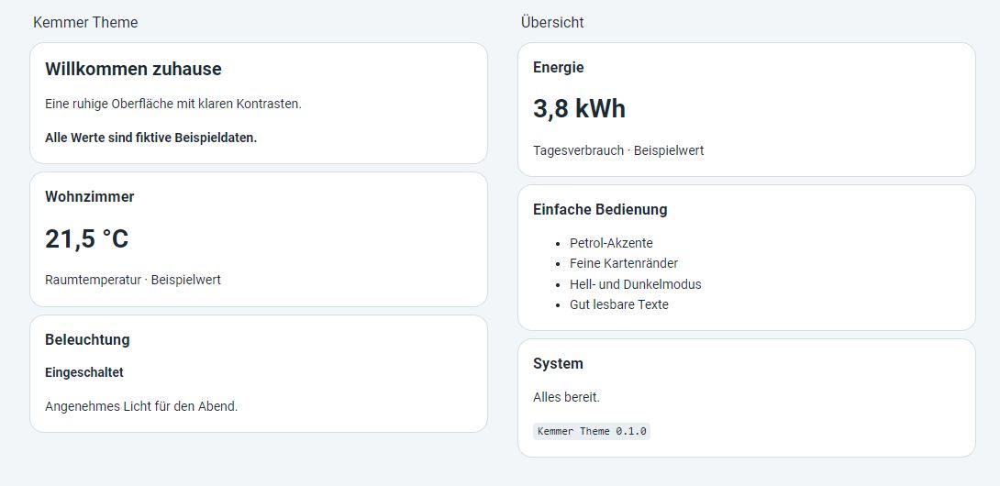
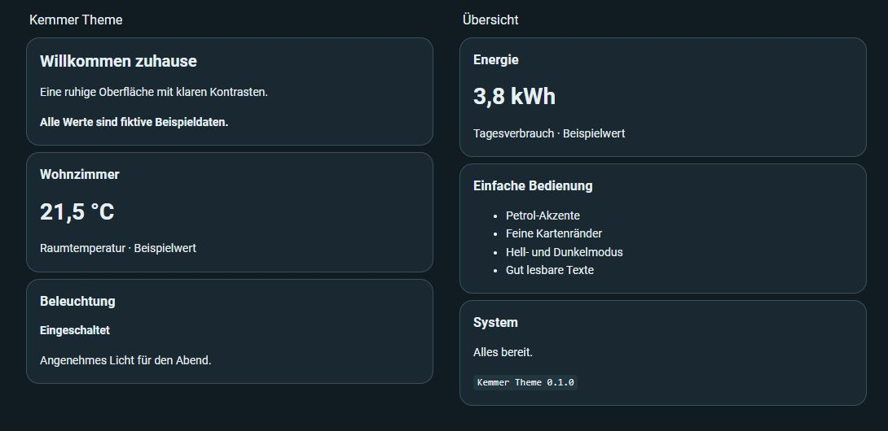

# Kemmer Theme

[](https://github.com/Johnyboy1984/kemmer-theme/actions/workflows/validate.yaml)
[](https://my.home-assistant.io/redirect/marketplace_repository/?owner=Johnyboy1984&repository=kemmer-theme&category=theme)

Eigenständiges Home-Assistant-Theme mit Petrol-Akzent, ruhigen Oberflächen und Hell-/Dunkelmodus. Version 0.1.1.

## Vorschau

Die folgenden Bilder sind echte Home-Assistant-Screenshots mit Kemmer Theme und ausschließlich fiktiven Beispieldaten. Persönliche Inhalte und die Seitenleiste wurden ausgeschnitten. Benutzerdefinierte Karten können anders aussehen.

### Hell



### Dunkel



## Gestaltung

- Heller Modus: kühles Grau, weiße Karten und dunkler Text.
- Dunkler Modus: blaugraue Flächen und heller Petrol-Akzent.
- 16-px-Kartenrundungen, feine Ränder, keine zusätzlichen Kartenschatten.
- Native Statusfarben der Geräte bleiben erhalten; Warnungen werden nicht pauschal durch die Akzentfarbe ersetzt.
- Keine externen Schriftarten, Bilder, JavaScript oder card-mod-Abhängigkeit.

## Installation

### Über Marketplace / HACS

Kemmer Theme ist im gemeinsamen Marketplace-/HACS-Katalog enthalten. Ein benutzerdefiniertes Repository muss nicht hinzugefügt werden.

1. Öffne den **Marketplace / HACS** in Home Assistant.
2. Suche nach **Kemmer Theme**, öffne den Eintrag und lade das Theme herunter.
3. Richte bei Bedarf das Theme-Verzeichnis wie unten beschrieben ein und wähle anschließend **Kemmer Theme** in deinem Benutzerprofil aus.

Falls der Eintrag direkt nach der Katalogaufnahme noch fehlt, aktualisiere den Marketplace-/HACS-Katalog und suche erneut.

### Manuelle Installation

Kopiere `themes/kemmer_theme.yaml` in deinen HA-Konfigurationsordner, z. B. nach `themes/kemmer/kemmer_theme.yaml`.

### Theme-Verzeichnis einrichten und Theme auswählen

Falls noch nicht eingerichtet, ergänze in `configuration.yaml`:

```yaml
frontend:
  themes: !include_dir_merge_named themes
```

Bestehende frontend-Einstellungen zusammenführen, keinen zweiten frontend-Block anlegen. Wenn du die Theme-Verzeichnis-Einstellung neu ergänzt hast, prüfe die Konfiguration und starte Home Assistant neu. Bei bereits aktiviertem Theme-Verzeichnis genügt die Aktion `frontend.reload_themes`.

Öffne danach dein **Benutzerprofil**, wähle **Kemmer Theme** und teste Hell/Dunkel. Das bisherige Theme bleibt parallel verfügbar. Dashboard- oder Kartenangaben mit `theme: Google Theme` überschreiben die Profilauswahl und müssen für einen Vergleich gezielt angepasst werden.

## Prüfung und Grenzen

YAML-Struktur und Textkontraste werden mit `python validate.py` geprüft (PyYAML erforderlich). Haupt- und Sekundärtext müssen mindestens 4,5:1 gegen die Kartenfläche erreichen. Die Beispielansicht wurde in Home Assistant 2026.11 in Hell und Dunkel visuell geprüft. Benutzerdefinierte Karten können eigene Farben und Layouts verwenden. Einige Frontend-Variablen sind versionsabhängig. Zielversion: HA 2026.11.

## Herkunft und Lizenz

Eigenständig erstellte Theme-Definition; kein Fork und kein übernommener Quellcode des Google Themes von JuanMTech. Kein Google-Logo, keine Google-Schrift oder sonstigen fremden Medien enthalten. Keine Verbindung zu Google oder zum Home-Assistant-Projekt. MIT-Lizenz, siehe LICENSE.
